<!-- Graphics live in assets/ and are generated by tools/build.py. Edit the text there, then run: python tools/build.py -->

<picture><source media="(prefers-color-scheme: dark)" srcset="assets/dark/hero.svg"></picture>

<a href="https://www.linkedin.com/in/YOUR-LINKEDIN"><picture><source media="(prefers-color-scheme: dark)" srcset="assets/dark/l-linkedin.svg">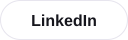</picture></a>
<a href="mailto:YOUR@EMAIL.COM"><picture><source media="(prefers-color-scheme: dark)" srcset="assets/dark/l-email.svg"></picture></a>
<a href="https://github.com/thuvarakayogarajah"><picture><source media="(prefers-color-scheme: dark)" srcset="assets/dark/l-github.svg"></picture></a>

<picture><source media="(prefers-color-scheme: dark)" srcset="assets/dark/now.svg">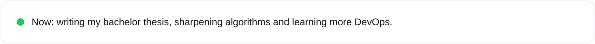</picture>
  

<picture><source media="(prefers-color-scheme: dark)" srcset="assets/dark/s01.svg">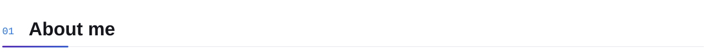</picture>

<picture><source media="(prefers-color-scheme: dark)" srcset="assets/dark/a1.svg">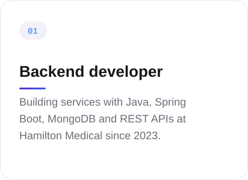</picture>
<picture><source media="(prefers-color-scheme: dark)" srcset="assets/dark/a2.svg">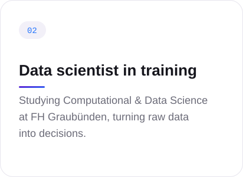</picture>
<picture><source media="(prefers-color-scheme: dark)" srcset="assets/dark/a3.svg">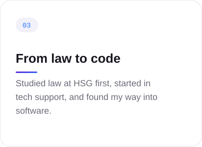</picture>

 

<picture><source media="(prefers-color-scheme: dark)" srcset="assets/dark/s02.svg">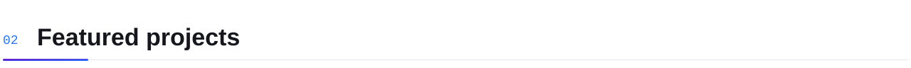</picture>

<a href="https://github.com/thuvarakayogarajah/REPO"><picture><source media="(prefers-color-scheme: dark)" srcset="assets/dark/p1.svg">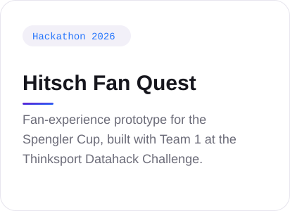</picture></a>
<picture><source media="(prefers-color-scheme: dark)" srcset="assets/dark/p2.svg">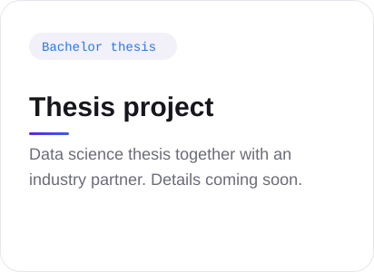</picture>
<picture><source media="(prefers-color-scheme: dark)" srcset="assets/dark/p3.svg">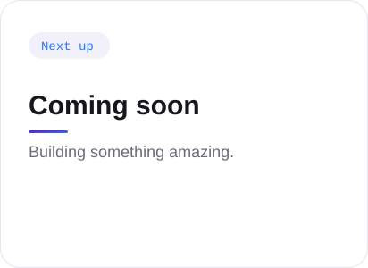</picture>

 

<picture><source media="(prefers-color-scheme: dark)" srcset="assets/dark/s03.svg">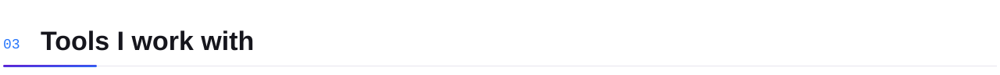</picture>

<picture><source media="(prefers-color-scheme: dark)" srcset="assets/dark/stack.svg">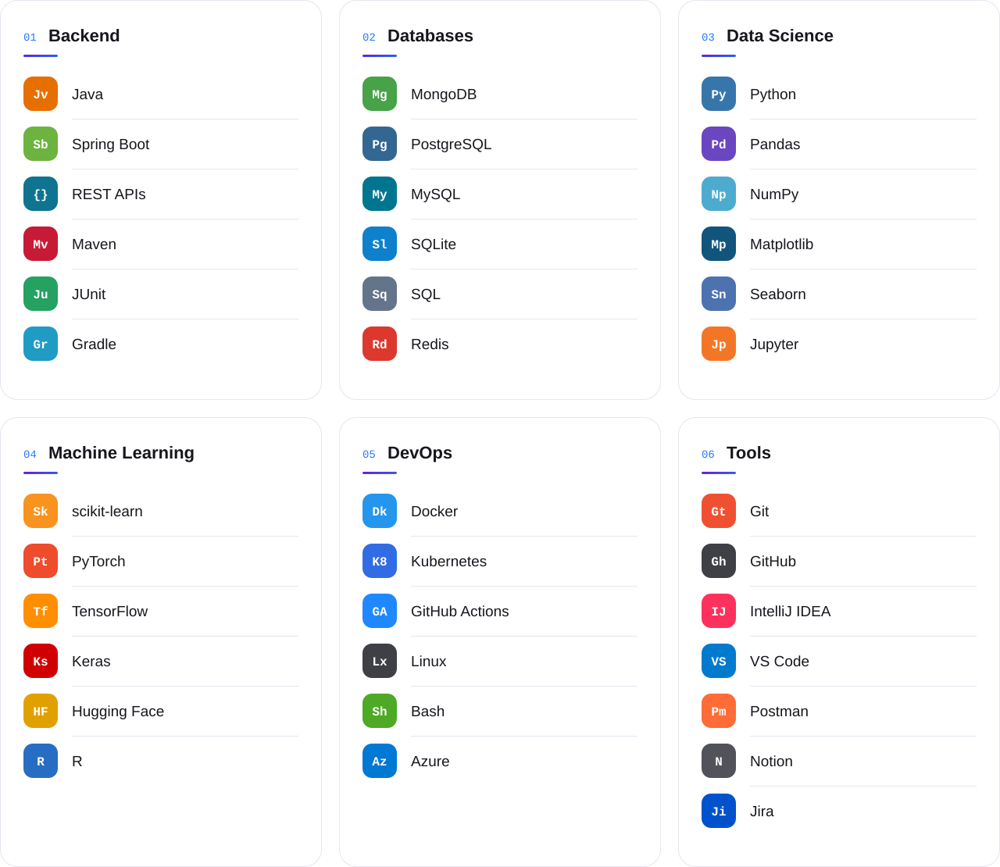</picture>
  

<a href="https://www.linkedin.com/in/YOUR-LINKEDIN"><picture><source media="(prefers-color-scheme: dark)" srcset="assets/dark/cta.svg">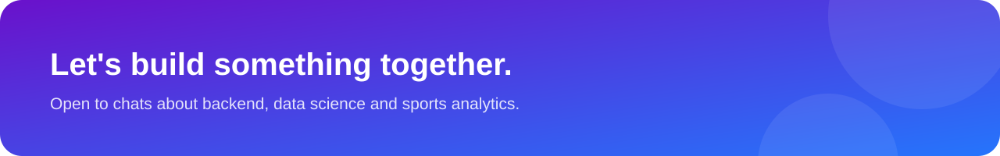</picture></a>
